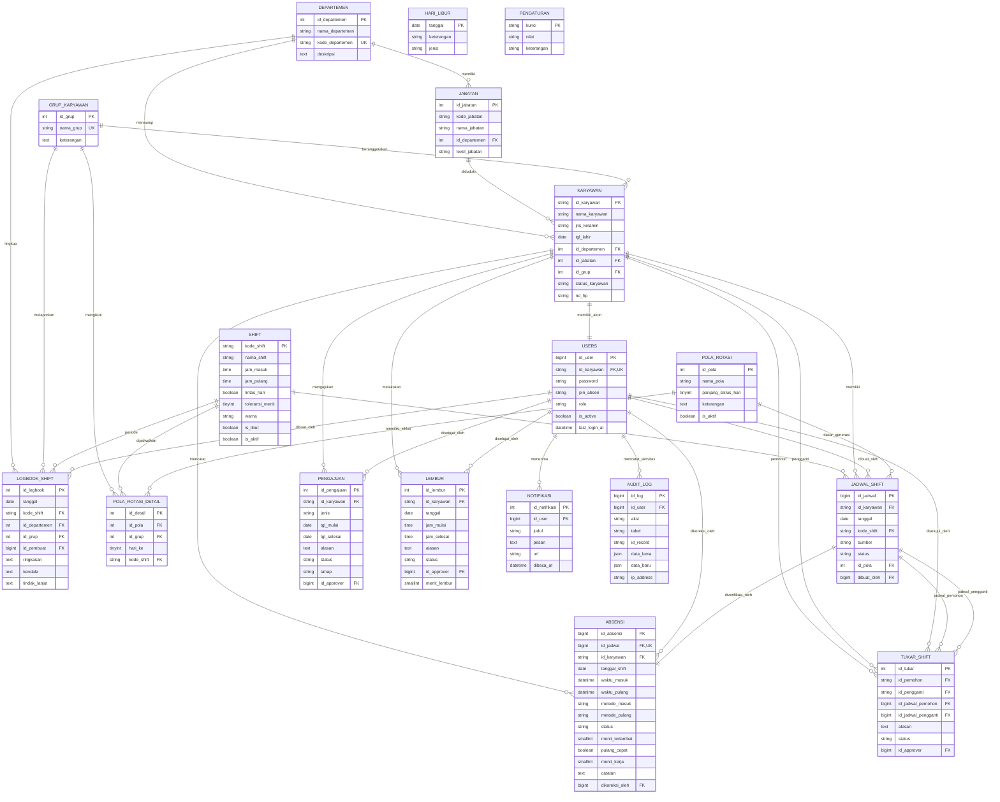

# Dokumentasi Entity-Relationship Diagram (ERD)
## Sistem Manajemen Shift & Absensi Operator (SIM-Shift DTY Indorama)

Dokumen ini memuat perancangan basis data relasional (ERD) untuk aplikasi Manajemen Shift dan Absensi Operator Pabrik, yang dibangun berdasarkan 5 tabel master perusahaan (hasil penyempurnaan kamus data Excel) dan tabel-tabel transaksi operasional.

File sumber DBML tersedia di: [`docs/ERD.dbml`](file:///d:/laragon/www/shift-absensi/docs/ERD.dbml). File ini dapat diunggah langsung ke [dbdiagram.io](https://dbdiagram.io), Navicat Data Modeler, atau draw.io.

---

### 1. Diagram Relasi Entitas (Mermaid ERD)

---

### 2. Klasifikasi dan Struktur Tabel

#### A. Tabel Master Organisasi (Turunan Excel Perusahaan)
1. **`departemen`**: Menyimpan daftar departemen/divisi (PRS, PRD, LGS, QCT, PCKG).
2. **`jabatan`**: Menentukan hirarki jabatan dan level otoritas (`DIREKTUR`, `HOD`, `SUPERVISOR`, `OPERATOR`).
3. **`grup_karyawan`**: Kelompok kerja rotasi (Grup A, B, C, D).
4. **`shift`**: Definisi jam kerja dan shift khusus:
   - `GS` (General Shift, 08:00 - 17:00)
   - `S1` (Shift Pagi, 07:00 - 15:00)
   - `S2` (Shift Siang, 15:00 - 23:00)
   - `S3` (Shift Malam Lintas Hari, 23:00 - 07:00, `lintas_hari = 1`)
   - `OFF` (Libur Rutin, jam NULL)
5. **`karyawan`**: Data induk kepegawaian dengan PK `id_karyawan` (VARCHAR 20, contoh `EMP-0001`).

#### B. Tabel Pola Rotasi & Penjadwalan
6. **`pola_rotasi`**: Header pola siklus kerja (contoh: Siklus 8 Hari 4 Regu).
7. **`pola_rotasi_detail`**: Matriks penugasan shift per regu pada hari ke-1 s/d ke-8 (`UNIQUE(id_pola, id_grup, hari_ke)`).
8. **`jadwal_shift`**: Kalender penugasan kerja per individu per tanggal. Menjamin integritas `UNIQUE(id_karyawan, tanggal)`.

#### C. Tabel Absensi & Transaksi Lapangan
9. **`absensi`**: Catatan kehadiran berbasis waktu server (`Asia/Jakarta`), terikat 1-ke-1 dengan jadwal shift (`id_jadwal`).
10. **`pengajuan`**: Izin, Sakit, dan Cuti bertingkat (Supervisor -> HOD jika > 3 hari).
11. **`tukar_shift`**: Transaksi tukar shift bilateral (Operator Pemohon <-> Operator Pengganti -> Approval Supervisor).
12. **`lembur`**: Surat perintah / pengajuan kerja lembur sebelum/sesudah shift.
13. **`logbook_shift`**: Serah terima kondisi operasional, mesin, kendala, dan tindak lanjut antar shift.

#### D. Tabel Tata Kelola & Sistem
14. **`users`**: Kredensial login akun (username = `id_karyawan`, password hash, PIN Kiosk).
15. **`hari_libur`**: Kalender hari libur nasional dan cuti bersama perusahaan.
16. **`pengaturan`**: Parameter bisnis dinamis (`toleransi_terlambat_menit`, `min_istirahat_jam`, dsb).
17. **`notifikasi`**: Pesan pemberitahuan status pengajuan dan peringatan jadwal.
18. **`audit_log`**: Jejak rekam perubahan data sensitif (`aksi`, `tabel`, `id_record`, `data_lama`, `data_baru`).

---

### 3. Cara Menggunakan File `docs/ERD.dbml`
1. Buka browser dan kunjungi [dbdiagram.io](https://dbdiagram.io).
2. Salin isi file [`docs/ERD.dbml`](file:///d:/laragon/www/shift-absensi/docs/ERD.dbml) ke panel editor sebelah kiri.
3. dbdiagram.io akan secara otomatis merender diagram visual interaktif lengkap dengan garis relasi kardinalitas.
4. Anda dapat mengekspor diagram ke format **PDF**, **PNG**, atau **SQL DDL**.
