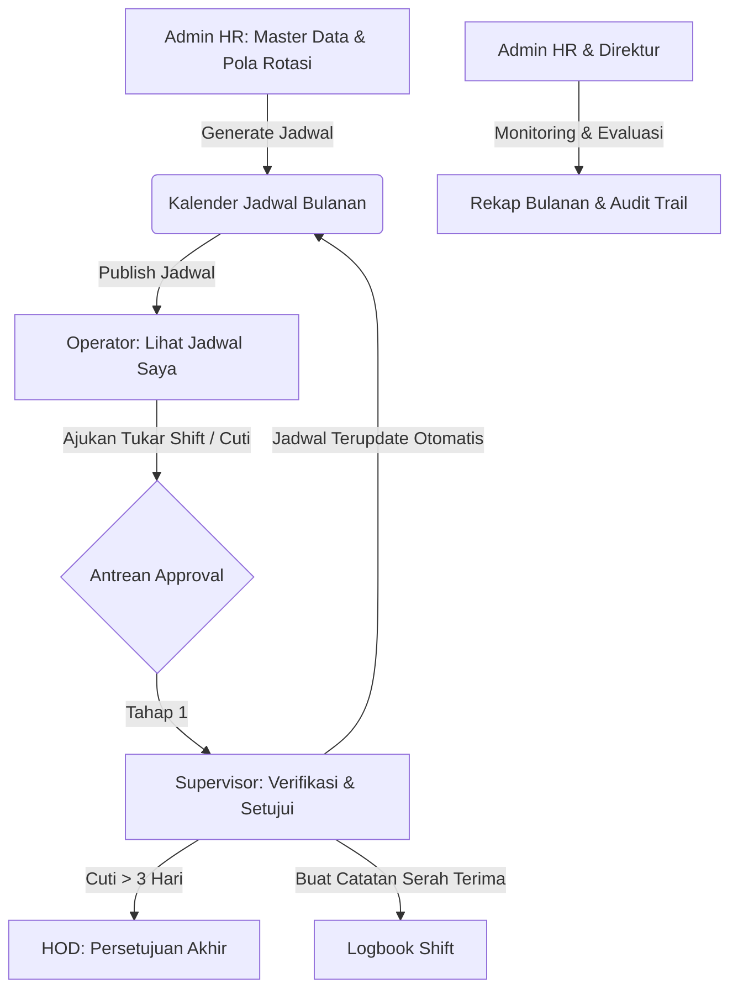

# Buku Panduan Pengguna & Skenario Demo (Guidebook)
## Sistem Manajemen Shift & Absensi Operator (SIM-Shift DTY Indorama)

---

## 1. Gambaran Umum Sistem

**SIM-Shift DTY Indorama** adalah platform manajemen operasional shift pabrik dan absensi terintegrasi yang dirancang untuk Divisi DTY PT Indo-Rama Synthetics Tbk dengan skema rotasi regu 24/7 (3 shift kerja + 1 regu libur rutin).

### 1.1 Spesifikasi Teknis & Lingkungan
- **Framework & Backend**: Laravel 11, PHP 8.2+
- **Frontend Reactive**: Livewire 3 + Alpine.js + Tailwind CSS
- **Database**: MySQL 8 (Mengikuti skema database industri manufaktur)
- **Zona Waktu Standar**: `Asia/Jakarta` (WIB) — Waktu pencatatan absensi murni didasarkan pada jam server, bukan jam perangkat client.
- **Standar Shift Pabrik**:
  - **GS (General Shift)**: 08:00 – 17:00 WIB (Senin – Jumat, akhir pekan & libur nasional OFF)
  - **S1 (Shift Pagi)**: 07:00 – 15:00 WIB
  - **S2 (Shift Siang)**: 15:00 – 23:00 WIB
  - **S3 (Shift Malam - Lintas Hari)**: 23:00 – 07:00 WIB (Dicatat pada tanggal *mulai* shift)
  - **OFF (Libur Rutin)**: Shift libur rotasi regu tanpa perlu absensi

---

## 2. Kredensial Akun & Persona Demo

Aplikasi dilengkapi dengan tombol **Login Cepat (1-Klik)** pada halaman login untuk mempermudah demonstrasi tanpa perlu mengetik manual:

| Peran (Role) | ID Karyawan (Username) | Nama Karyawan | Departemen | Kata Sandi | PIN Kiosk |
|---|---|---|---|---|---|
| **Admin HR** | `EMP-0001` | **Subani** | Personalia (PRS) | `password` | `123456` |
| **Direktur** | `EMP-0002` | **Jerry** | Direksi (PRS) | `password` | `123456` |
| **HOD Produksi** | `EMP-0004` | **Satrio** | Produksi (PRD) | `password` | `123456` |
| **Supervisor Produksi** | `EMP-0009` | **Gilang** | Produksi (PRD) | `password` | `123456` |
| **Operator Produksi** | `EMP-0013` | **Sarwan** | Produksi (PRD - Grup A) | `password` | `123456` |

---

## 3. Matriks Otorisasi & Hak Akses Menu

Sesuai rancangan *Role-Based Access Control* (RBAC) pada dokumen arsitektur:

| Modul / Menu | URL | Admin HR | Direktur | HOD | Supervisor | Operator |
|---|---|:---:|:---:|:---:|:---:|:---:|
| **Dashboard** | `/dashboard` | Akses Penuh | Eksekutif | Dept. Sendiri | Tim Shift | Beranda Operator |
| **Kalender Jadwal** | `/jadwal` | Semua Dept | Semua Dept | Dept. Sendiri | Tim (Bisa Publish) | Jadwal Sendiri (PUBLISHED) |
| **Monitoring Absensi** | `/absensi/koreksi` | Semua Dept | Semua Dept | Dept. Sendiri | Tim (Bisa Koreksi) | Riwayat Sendiri |
| **Antrean Approval** | `/pengajuan-approval` | Lihat Semua (No Approve) | Lihat (No Approve) | Approve Tahap 2 | Approve Tahap 1 | Ajukan Permohonan |
| **Logbook Shift** | `/logbook` | Lihat Semua | Lihat | Lihat | **Buat & Isi Logbook** | ❌ (403) |
| **Rekap Bulanan** | `/rekap` | Semua Dept | Semua Dept | Dept. Sendiri | Tim Sendiri | ❌ (403) |
| **Data Karyawan** | `/master/karyawan` | Kelola + Akun & PIN | ❌ (403) | ❌ (403) | ❌ (403) | ❌ (403) |
| **Pola Rotasi** | `/pola-rotasi` | Kelola + Generate | ❌ (403) | ❌ (403) | ❌ (403) | ❌ (403) |
| **Hari Libur** | `/hari-libur` | Kelola Libur | ❌ (403) | ❌ (403) | ❌ (403) | ❌ (403) |
| **Pengaturan Sistem**| `/pengaturan` | Parameter Bisnis | ❌ (403) | ❌ (403) | ❌ (403) | ❌ (403) |
| **Audit Log** | `/audit-log` | Jejak Audit | ❌ (403) | ❌ (403) | ❌ (403) | ❌ (403) |

---

## 4. Alur Kerja & Fitur Utama



---

## 5. Tata Cara & Skenario Demo (Panduan Presentasi 10 Menit)

Agar saat presentasi atau demo di depan dosen/penguji berjalan lancar dan memukau, ikuti urutan skenario 7 babak di bawah ini:

### Babak 1: Login Cepat & Pengenalan Dashboard (2 Menit)
1. Buka browser dan arahkan ke: `http://127.0.0.1:8000/login`
2. Tunjukkan fitur **Akun Uji Coba (1-Klik)** di bawah tombol Masuk.
3. Klik tombol **Admin HR (EMP-0001)**. Field username & password terisi otomatis, lalu klik **Masuk**.
4. **Poin yang Dijelaskan di Dashboard**:
   - Tunjukkan kartu KPI ringkas (33 Karyawan, 5 Departemen, 4 Grup Regu, 5 Shift).
   - Tunjukkan matriks standar shift pabrik (GS, OFF, S1, S2, S3 lintas hari).
   - Tunjukkan penunjuk waktu server terpusat di `Asia/Jakarta`.
   - Tunjukkan topbar yang bersih tanpa klaim yang tidak berdasar.

### Babak 2: Konfigurasi Parameter Bisnis & Kelola Akun Karyawan (2 Menit)
1. Di sidebar grup **Konfigurasi & Master**, buka menu **Pengaturan Sistem**:
   - Jelaskan bahwa aturan absensi tidak di-hardcode, melainkan membaca parameter database:
     - Toleransi keterlambatan (10 menit)
     - Jendela absen masuk (60 menit sebelum shift)
     - Ambang batas eskalasi cuti ke HOD (3 hari)
     - Waktu istirahat minimal antar shift (8 jam)
   - Klik **Ubah Nilai** pada salah satu parameter untuk mendemonstrasikan fleksibilitas sistem.
2. Buka menu **Data Karyawan**:
   - Tunjukkan tabel daftar 33 karyawan lintas 5 departemen.
   - Pada salah satu karyawan, klik ikon **Kunci** (*Kelola Akun & PIN Absen*).
   - **Tunjukkan Keamanan PIN**:
     - Masukkan PIN baru 6-digit angka.
     - Jelaskan bahwa PIN disimpan murni sebagai hash enkripsi satu arah (bcrypt) dan tidak pernah ditampilkan dalam teks biasa.
     - Tunjukkan tombol aksi cepat *Reset ke 'password'* dan *Reset ke '123456'*.

### Babak 3: Pola Rotasi & Kalender Jadwal Terpublikasi (1.5 Menit)
1. Buka menu **Pola Rotasi**:
   - Tunjukkan matriks siklus rotasi 4 grup 8 hari (2 hari S1, 2 hari S2, 2 hari S3, 2 hari OFF bergantian).
   - Tunjukkan form generator jadwal otomatis per departemen dan bulan.
2. Buka menu **Kalender Jadwal**:
   - Tunjukkan grid visual jadwal kerja per hari untuk seluruh regu.
   - Tunjukkan kode warna shift: GS (Biru), S1 (Kuning), S2 (Oranye), S3 (Indigo), OFF (Abu-abu).
   - Tunjukkan tombol **Publikasikan Jadwal** untuk jadwal berstatus DRAFT agar resmi terlihat oleh operator.

### Babak 4: Sisi Operator – Mengajukan Permohonan (1.5 Menit)
1. Klik tombol **Logout** di pojok kiri bawah sidebar.
2. Di halaman login, klik tombol demo **Operator (EMP-0013)** (Sarwan - Operator Produksi) $\rightarrow$ klik **Masuk**.
3. **Poin yang Dijelaskan**:
   - Tunjukkan bahwa Operator memiliki menu yang minimalis (hanya Beranda, Jadwal Saya, Riwayat Absensi, dan Pengajuan).
   - Menu Konfigurasi & Master sama sekali tidak muncul.
4. Buka menu **Pengajuan & Tukar Shift**:
   - Klik tombol **Ajukan Tukar Shift**.
   - Pilih jadwal yang ingin ditukar, pilih rekan kerja pengganti di departemen Produksi, masukkan alasan, lalu klik **Kirim Permohonan**.
   - Status pengajuan akan berstatus `MENUNGGU_PENGGANTI`.

### Babak 5: Supervisor & HOD – Persetujuan Berjenjang & Logbook (2 Menit)
1. Logout, lalu login sebagai **Spv PRD (EMP-0009)** (Gilang - Supervisor Produksi).
2. **Poin yang Dijelaskan**:
   - Buka menu **Antrean Approval**:
     - Tunjukkan bahwa Supervisor melihat permohonan tim Produksi.
     - Klik pengajuan, dan tunjukkan tersedianya tombol aksi **Setujui** dan **Tolak**.
     - Klik **Setujui**. Tunjukkan bahwa jadwal kedua karyawan langsung otomatis diperbarui di database secara transaksional (`DB::transaction`).
3. Buka menu **Logbook Shift**:
   - Tunjukkan bahwa tombol **+ Buat Catatan Logbook** aktif untuk Supervisor.
   - Buka modal, masukkan ringkasan produksi, kendala mesin/material, dan tindak lanjut untuk regu berikutnya.
   - Simpan catatan serah terima shift.
4. *(Opsional)* Login sebagai **HOD PRD (EMP-0004)** (Satrio):
   - Jelaskan bahwa jika permohonan cuti lebih dari 3 hari, tahap persetujuan akan otomatis dieskalasi ke HOD setelah disetujui Supervisor.

### Babak 6: Uji Otorisasi Admin HR pada Antrean Approval (1 Menit)
1. Logout, lalu login kembali sebagai **Admin HR (EMP-0001)** (Subani).
2. Buka menu **Antrean Approval**:
   - **Tunjukkan Kepatuhan Bisnis (Aturan Otorisasi BR-11 SRS)**:
     - Admin HR dapat memantau seluruh pengajuan dari semua departemen.
     - **TIDAK ADA tombol Setuju maupun Tolak** di panel Admin HR.
     - Jelaskan bahwa hak persetujuan adalah wewenang hierarki operasional (Supervisor dan HOD), bukan bagian HRD.

### Babak 7: Rekapitulasi Eksekutif & Bukti Audit Trail (1 Menit)
1. Buka menu **Rekap Bulanan**:
   - Tunjukkan agregasi otomatis kehadiran, total insiden terlambat, alpa, izin/cuti, dan total lembur per karyawan.
   - Tunjukkan filter bulan dan departemen.
2. Buka menu **Audit Log**:
   - Tunjukkan bahwa setiap aksi yang baru saja dilakukan pada Babak 2 sampai Babak 5 (perubahan parameter, mutasi akun, publikasi jadwal, approval, logbook) telah **tercatat secara otomatis dan permanen** lengkap dengan timestamp, user pelaksana, nama tabel, ID record, data lama vs data baru JSON, dan IP address.

---

## 6. Pertanyaan Umum Saat Ujian / Demo (FAQ)

**Q: Mengapa jam shift malam S3 (23:00 - 07:00) yang melewati tengah malam tetap masuk di tanggal hari sebelumnya?**  
*A: Sesuai Aturan Domain Bisnis BR-03 (SRS), `tanggal_shift` adalah tanggal dimulainya shift kerja. Karyawan yang mulai masuk pukul 23:00 tanggal 20 Oktober tetap dihitung sebagai jadwal kerja tanggal 20 Oktober meskipun pulang pukul 07:00 tanggal 21 Oktober.*

**Q: Bagaimana sistem mencegah kecurangan titip absen di kiosk?**  
*A: Setiap operator memiliki ID unik dan PIN 6 digit pribadi yang di-hash dengan bcrypt. Validasi waktu absensi 100% menggunakan waktu server (`now('Asia/Jakarta')`) dan supervisor memantau absensi regu secara langsung melalui monitoring absensi.*

**Q: Mengapa Admin HR tidak bisa menyetujui cuti atau tukar shift?**  
*A: Sesuai aturan tata kelola pabrik (BR-11 SRS.md), izin libur dan pertukaran shift berkaitan langsung dengan ketersediaan kapasitas lini mesin yang hanya diketahui oleh Supervisor dan HOD lantai produksi. Admin HR bertindak sebagai pengawas tata usaha dan penyedia master data.*

---

## 7. Perintah Menjalankan Pengujian Otomatis

Untuk membuktikan keandalan kode kepada penguji, jalankan perintah pengujian fitur langsung dari terminal:

```bash
php artisan test
```

Semua 57 skenario pengujian (RBAC 5 role, generator jadwal, mitigasi shift malam, approval berjenjang, dan audit log) terverifikasi **100% Passed**.
