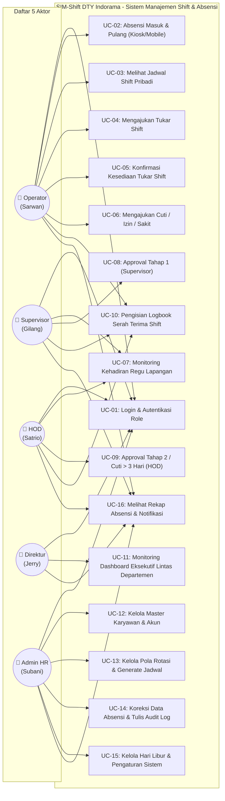

# Dokumentasi Use Case Diagram (5 Aktor)
## Sistem Manajemen Shift & Absensi Operator (SIM-Shift DTY Indorama)

Dokumen ini mendefinisikan spesifikasi fungsional sistem melalui **Use Case Diagram** yang memetakan interaksi antara **5 Aktor Utama** dengan modul-modul sistem sesuai hak akses berbasis role (Policy) pada spesifikasi aturan domain bisnis (PRD/SRS).

---

### 1. Definisi 5 Aktor Sistem

| No | Aktor | Contoh Akun Uji Coba | Deskripsi & Batas Wewenang |
| :---: | :--- | :--- | :--- |
| 1 | **OPERATOR** | `EMP-0013` (Sarwan) | Pengguna operasional lapangan. Melakukan absensi via Kiosk/Mobile, melihat jadwal kerja diri sendiri, mengajukan permohonan izin/sakit/cuti, mengajukan tukar shift bilateral dengan rekan kerja, serta mengisi/melihat logbook shift. |
| 2 | **SUPERVISOR** | `EMP-0009` (Gilang) | Pengawas lini produksi departemen terkait. Memantau kehadiran regu kerja, menyetujui/menolak pengajuan cuti/izin tahap 1, menyetujui tukar shift anggota tim, membuat dan menandatangani logbook serah terima shift. |
| 3 | **HOD (Head of Department)** | `EMP-0004` (Satrio) | Kepala departemen. Memonitor rekap kehadiran departemennya, melakukan approval final untuk pengajuan cuti jangka panjang (> 3 hari kerja), memvalidasi kebutuhan lembur, dan mengaudit logbook shift. |
| 4 | **DIREKTUR** | `EMP-0002` (Jerry) | Eksekutif perusahaan. Memiliki akses read-only menyeluruh (lintas seluruh departemen) untuk memantau performa kehadiran pabrik, tren keterlambatan, utilisasi tenaga kerja, dan laporan analitik eksekutif. |
| 5 | **ADMIN HR (Personalia)** | `EMP-0001` (Subani) | Administrator tata kelola kepegawaian dan sistem. Mengelola master data (karyawan, shift, pola rotasi), generate jadwal bulanan, konfigurasi parameter bisnis, kalender hari libur, koreksi absensi lapangan, dan memantau audit log. |

---

### 2. Use Case Diagram (Mermaid)

---

### 3. Matriks Hak Akses Use Case (Authorization Matrix)

| Kode UC | Nama Use Case | Operator | Supervisor | HOD | Direktur | Admin HR |
| :--- | :--- | :---: | :---: | :---: | :---: | :---: |
| **UC-01** | Login, Logout & Ganti Password | ✅ | ✅ | ✅ | ✅ | ✅ |
| **UC-02** | Absensi Kiosk (Waktu Server Asia/Jakarta) | ✅ | ✅ | - | - | - |
| **UC-03** | Lihat Kalender Jadwal Shift Pribadi | ✅ | ✅ | - | - | - |
| **UC-04** | Ajukan Permohonan Tukar Shift Bilateral | ✅ | - | - | - | - |
| **UC-05** | Konfirmasi Tukar Shift dari Rekan Pengganti | ✅ | - | - | - | - |
| **UC-06** | Pengajuan Izin / Sakit / Cuti Tahunan | ✅ | ✅ | ✅ | - | - |
| **UC-07** | Monitoring Kehadiran Realtime Tim (Dept Sendiri) | - | ✅ | ✅ | - | ✅ |
| **UC-08** | Approval Tahap 1 (Cuti <= 3 hari, Tukar Shift, Lembur) | - | ✅ | - | - | - |
| **UC-09** | Approval Tahap 2 (Cuti > 3 hari tingkat HOD) | - | - | ✅ | - | - |
| **UC-10** | Input & Review Logbook Serah Terima Shift | ✅ | ✅ | ✅ | - | ✅ |
| **UC-11** | Dashboard Eksekutif & Laporan Lintas Departemen | - | - | - | ✅ | ✅ |
| **UC-12** | Kelola Master Data Karyawan, Departemen, Jabatan | - | - | - | - | ✅ |
| **UC-13** | Konfigurasi Pola Rotasi & Generate Jadwal Bulanan | - | - | - | - | ✅ |
| **UC-14** | Koreksi Absensi Lapangan (Wajib Alasan & Audit Log) | - | - | - | - | ✅ |
| **UC-15** | Kelola Hari Libur & Parameter Bisnis (Tabel Pengaturan) | - | - | - | - | ✅ |
| **UC-16** | Menerima Notifikasi In-App & Riwayat Aktivitas | ✅ | ✅ | ✅ | ✅ | ✅ |
